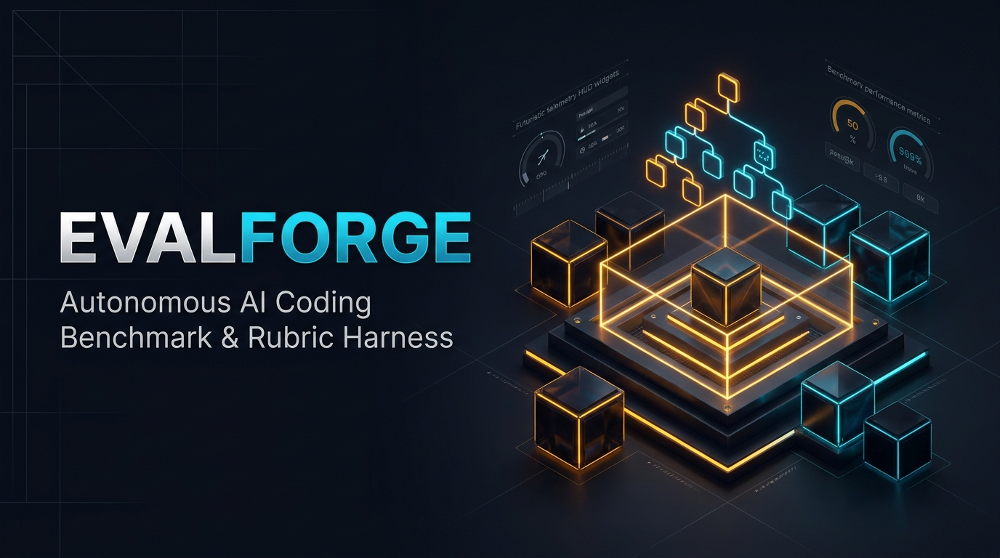
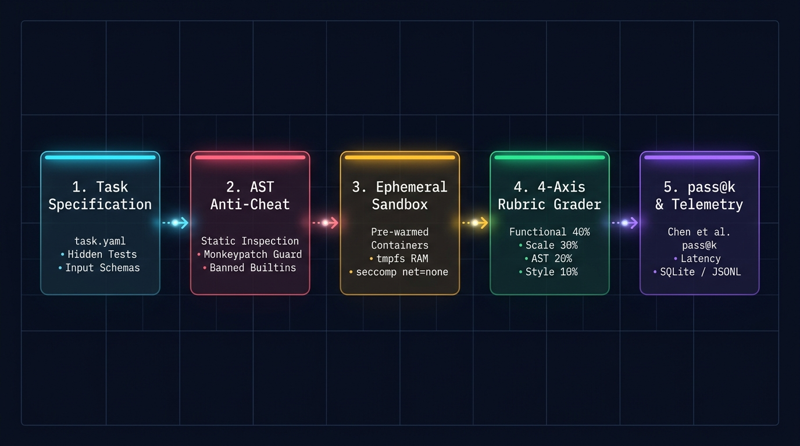
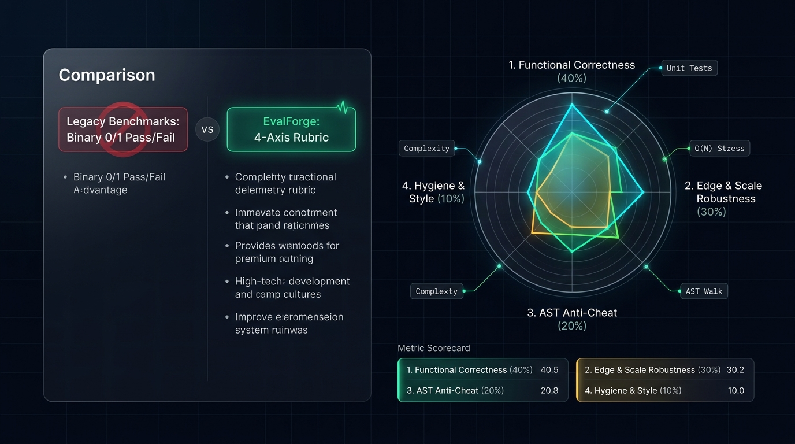

<div align="center">



# EvalForge — AI Coding Benchmark & Rubric Grading Harness

[](https://python.org)
[](https://fastapi.tiangolo.com)
[](https://docker.com)
[](https://arxiv.org/abs/2107.03374)
[](LICENSE)

> **The uncompromising, lightning-fast evaluation forge that measures true algorithmic competence and engineering rigor in AI coding models—guaranteed tamper-proof, sub-second, and graded like a staff software engineer.**

</div>

---

## Overview

EvalForge is a high-throughput, hardened evaluation harness for benchmarking LLM code generation. Modern coding models easily game legacy benchmarks like HumanEval through training data contamination and unit-test reward hacking (e.g. hardcoding literal return tables or monkeypatching `pytest`).

EvalForge replaces binary pass/fail assertions with a **4-axis rubric grading engine** running inside an **ephemeral pre-warmed Docker sandbox pool** with sub-150ms execution dispatch overhead.

---

## Workflow & Execution Pipeline

EvalForge executes benchmark tasks through a hardened 5-stage sequential pipeline designed for sub-150ms dispatch overhead and zero reward-hacking:

<div align="center">
  
</div>

### The 5 Pipeline Stages:

1. **Task Specification & Ingestion**:
   - Ingests structured task suites defined in canonical `task.yaml` schemas.
   - Decouples visible unit tests (provided to model prompts) from hidden boundary and algorithmic stress test suites.
   - Validates language runtimes (Python 3.11, C++20) and memory/CPU limits.

2. **AST Anti-Cheat Gatekeeper**:
   - Performs a static Python AST syntax traversal prior to execution.
   - Detects and disqualifies suspicious patterns: hardcoded literal return tables matching test cases, `sys.exit(0)` evasion tricks, `pytest` / test runner monkeypatching.
   - Enforces a zero-tolerance policy against banned builtins (`eval`, `exec`, `compile`) and restricted system modules (`os`, `subprocess`, `socket`, `ctypes`).

3. **Ephemeral Pre-Warmed Docker Sandbox Pool**:
   - Maintains a warm pool of pre-spawned Docker containers, slashing container cold-start latency from ~2,000ms down to **sub-150ms**.
   - Dispatches candidate code onto isolated `tmpfs` RAM-backed filesystems that evaporate instantly upon test completion.
   - Hardens Linux kernel boundaries: `network_mode="none"` (zero external network), `read_only=True` rootfs, `cap_drop=["ALL"]`, unprivileged UID (`10001:10001`), and 256MB RAM / 1.0 vCPU / 64 PIDs quotas.

4. **4-Axis Rubric Grading Engine**:
   - Computes weighted scorecards across 4 orthogonal dimensions rather than binary pass/fail.
   - Tests functional accuracy, asymptotic scalability ($O(N)$ vs $O(N^2)$), AST algorithmic authenticity, and clean code hygiene.

5. **Unbiased pass@k & Telemetry Aggregator**:
   - Calculates mathematically unbiased `pass@k` estimators ($k \in \{1, 5\}$ over $n$ samples) using Chen et al. (2021).
   - Records execution latency histograms, memory peaks, and rubric breakdowns.
   - Streams telemetry directly to SQLite and append-only JSONL files with sub-millisecond writes.

---

## 4-Axis Rubric vs. Legacy Benchmarks

<div align="center">
  
</div>

| Rubric Axis | Weight | Evaluation Method & Verification Criteria |
| :--- | :---: | :--- |
| **1. Functional Correctness** | **40%** | Standard visible test validation verifying basic input-output contracts and API signatures. |
| **2. Edge-Case & Scale Robustness** | **30%** | Hidden boundary test suites, null/empty collections, integer overflows, and strict time limits testing $O(N)$ vs $O(N^2)$ scalability. |
| **3. Anti-Cheat & AST Integrity** | **20%** | Static AST analysis ensuring genuine algorithmic solutions rather than lookup table hacks or test framework evasion. |
| **4. Code Hygiene & Style** | **10%** | Cyclomatic complexity ceilings ($\le 10$), typing hints adherence, and PEP 8 / Clean Code standards. |

---

## Key Capabilities

* **Pre-Warmed Docker Container Pool**: Maintains an active pool of warm containers with health watchdog recycling.
* **Hermetic Kernel Sandbox**:
  - `network_mode="none"`: Absolute zero-network execution (loopback only, zero sockets).
  - Strict resource constraints: 256MB RAM cap, 1.0 vCPU quota, 64 PIDs ceiling (fork-bomb protection).
  - Hardened isolation: Read-only root filesystem (`read_only=True`), dropped kernel capabilities (`cap_drop=["ALL"]`), unprivileged user (`10001:10001`), and 2.0-second execution watchdog.
* **AST Anti-Cheat & Anti-Reward-Hacking**: Static Python AST analyzer detecting hardcoded literal return tables, `sys.exit(0)` evasion, pytest monkeypatching, dangerous builtins (`eval`, `exec`), and banned system modules.
* **Unbiased `pass@k` Estimators**: Mathematically unbiased Chen et al. (2021) estimator for $k \in \{1, 5\}$ over $n$ samples.
* **30 Curated Benchmark Tasks**: 20 Python 3.11 and 10 C++20 production-grade challenges (concurrency, data structures, streaming tokenizers, distributed algorithms) with visible and hidden test suites.
* **Dual Interface**: Typer & Rich interactive terminal CLI and high-throughput FastAPI REST API.

---

## Pre-Build Engineering Documentation

EvalForge is built according to rigorous systems engineering specifications:

| Document | Description | Direct File Link |
| :--- | :--- | :--- |
| **Product Requirements Document (PRD)** | Problem statement, user personas, vision, must-have features, user flows, success metrics, and scope ceiling. | [PRD.md](docs/PRD.md) |
| **Technical Architecture** | Complete tech stack, repository map, SQLite schema, JSONL telemetry, Pydantic models, container pool lifecycle, and Mermaid diagrams. | [ARCHITECTURE.md](docs/ARCHITECTURE.md) |
| **Security & Sandboxing** | Linux kernel isolation boundary, AST visitor rules, error recovery guide, and STRIDE threat model. | [SECURITY.md](docs/SECURITY.md) |
| **Interface & Integration Spec** | CLI commands, exit codes, FastAPI OpenAPI endpoints, `task.yaml` schema, and Rich / Web visual design tokens. | [INTERFACE_SPEC.md](docs/INTERFACE_SPEC.md) |
| **Feature Build Tickets** | 12 atomic, sequential engineering tickets with exact AI coding prompts and acceptance criteria. | [FEATURE_TICKETS.md](docs/FEATURE_TICKETS.md) |

---

## Quickstart Guide

### Prerequisites
* **Python 3.11+**
* **Docker Engine** running locally (Docker Desktop or Docker daemon socket)

### 1. Installation
Clone the repository and install dependencies:
```bash
git clone https://github.com/iSHAANphaye/EvalForge.git
cd EvalForge
python -m venv .venv
# Windows:
.venv\Scripts\activate
# Linux/macOS:
source .venv/bin/activate

pip install -e ".[dev]"
```

### 2. Build Sandbox Docker Images
Build the hardened Python 3.11 and C++20 sandbox container images:
```bash
python scripts/build_sandboxes.py
```

### 3. Evaluate a Candidate Solution via CLI
Evaluate a model's solution against task `EF-PY-001` with real-time rubric scorecards:
```bash
evalforge run --task-id EF-PY-001 --candidate-file solutions/lru_cache.py --model-name "qwen2.5-coder-7b"
```

### 4. Run Full Benchmark
Execute the complete 30-task benchmark across 5 samples per task to calculate unbiased pass@1 and pass@5:
```bash
evalforge benchmark --suite all --candidates-dir ./model_outputs/ --samples-per-task 5
```

### 5. Launch FastAPI REST Service
Start the REST API server:
```bash
uvicorn evalforge.api.app:app --host 127.0.0.1 --port 8000 --reload
```
Interactive OpenAPI documentation is available at `http://127.0.0.1:8000/docs`.

---

## Repository Map

```
EvalForge/
├── README.md
├── pyproject.toml
├── Dockerfile.sandbox.python
├── Dockerfile.sandbox.cpp
├── docs/
│   ├── assets/                 # Hero banner, pipeline diagram, and rubric visuals
│   │   ├── evalforge-hero-banner.jpg
│   │   ├── evalforge-pipeline-diagram.jpg
│   │   └── evalforge-rubric-radar.jpg
│   ├── PRD.md                  # Product Requirements Document
│   ├── ARCHITECTURE.md         # Technical Architecture Document
│   ├── SECURITY.md             # Security & Access Document
│   ├── INTERFACE_SPEC.md       # Frontend & Integration Specification
│   └── FEATURE_TICKETS.md      # Feature Build Ticket List
├── evalforge/
│   ├── main.py                 # CLI entrypoint (Typer/Rich)
│   ├── api/                    # FastAPI routes & schemas
│   ├── core/                   # Config, constants & exceptions
│   ├── sandbox/                # Pre-warmed pool manager & runner
│   ├── grader/                 # 4-axis rubric & AST inspector
│   ├── tasks/                  # Task registry & 30 curated YAML tasks
│   └── storage/                # SQLite DB & JSONL streaming logger
└── tests/                      # Pytest suite & integration tests
```

---

## License

Apache-2.0. See `LICENSE` for details.
