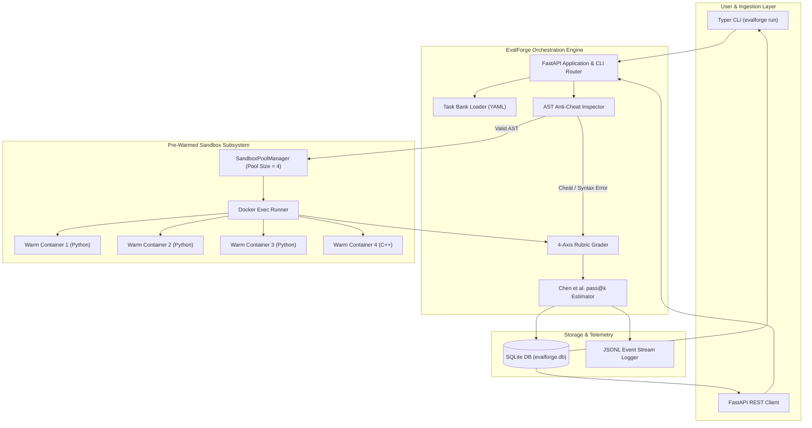

# EvalForge — Technical Architecture Document

---

## 1. Tech Stack & Architectural Reasoning

EvalForge is engineered for deterministic, high-throughput, and tamper-proof evaluation of code generated by Large Language Models.

| Component | Technology | Version | Architectural Reasoning |
| :--- | :--- | :--- | :--- |
| **Runtime Language** | Python | `3.11.x` | Modern standard library AST enhancements, improved exception groups, and ~25% runtime performance improvements over Python 3.10. |
| **API Framework** | FastAPI | `>= 0.115.0` | Async-native architecture, automated OpenAPI/JSON-schema generation, sub-millisecond request routing, and native Pydantic integration. |
| **Data Validation** | Pydantic | `>= 2.8.0` | High-performance Rust-backed core (`pydantic-core`) ensures schema validation and serialization overhead remain under 0.5ms per request. |
| **Container Engine** | Docker SDK for Python (`docker-py`) | `>= 7.1.0` | Direct UNIX socket / named pipe communication with the Docker daemon, enabling low-level container management, exec APIs, and cgroup control. |
| **Test Runners** | Pytest (Python) / GTest (C++) | Pytest `8.x` / GTest `1.14+` | Industry standard execution harnesses inside containers, running custom JSON-reporter fixtures to output structured test assertions. |
| **Static Code Inspection** | Python `ast` module | Built-in | Zero-dependency, sub-millisecond AST parsing and visitor traversal for syntax validation, anti-cheat detection, and structural analysis. |
| **Database & Metadata** | SQLite 3 | Built-in (via `aiosqlite`) | Zero-configuration, serverless, single-file relational storage with ACID compliance for task registries, evaluation runs, and leaderboards. |
| **Structured Telemetry** | JSONL (JSON Lines) | Custom streaming writer | Append-only, crash-resilient event logging for raw evaluation traces, execution logs, and detailed rubric scoring records. |
| **Terminal Interface** | Typer & Rich | Typer `>= 0.12`, Rich `>= 13.7` | Type-safe CLI command routing with interactive progress spinners, formatted tables, and colored terminal scorecards. |
| **CI / Automation** | GitHub Actions | Standard runners | Automated unit testing, linting (`ruff`), static typing (`mypy`), and Docker image build verification. |

---

## 2. Complete Repository File & Folder Structure

```
EvalForge/
├── .env.example
├── .gitignore
├── pyproject.toml
├── README.md
├── Dockerfile.sandbox.python
├── Dockerfile.sandbox.cpp
├── docs/
│   ├── PRD.md
│   ├── ARCHITECTURE.md
│   ├── SECURITY.md
│   ├── INTERFACE_SPEC.md
│   └── FEATURE_TICKETS.md
├── evalforge/
│   ├── __init__.py
│   ├── main.py                     # CLI entrypoint (Typer commands)
│   ├── api/
│   │   ├── __init__.py
│   │   ├── app.py                  # FastAPI application factory & middleware
│   │   ├── routes.py               # REST API endpoints (/api/v1/...)
│   │   └── schemas.py              # Request and response Pydantic models
│   ├── core/
│   │   ├── __init__.py
│   │   ├── config.py               # Pydantic Settings & environment validation
│   │   ├── constants.py            # Rubric weights, timeouts, resource caps
│   │   └── exceptions.py           # Typed domain exception hierarchy
│   ├── sandbox/
│   │   ├── __init__.py
│   │   ├── manager.py              # Pre-warmed container pool manager
│   │   ├── runner.py               # Container execution & docker-exec wrapper
│   │   ├── isolation.py            # Cgroups, security opts, cap-drops, and tmpfs
│   │   └── cleaner.py              # Ephemeral workspace wipe and process killer
│   ├── grader/
│   │   ├── __init__.py
│   │   ├── rubric.py               # 4-axis Rubric scoring engine (40/30/20/10)
│   │   ├── ast_inspector.py        # Python AST visitor for anti-cheat & anti-hack
│   │   ├── functional.py           # Test runner stdout/stderr parser
│   │   └── metrics.py              # Chen et al. pass@k unbiased estimator
│   ├── tasks/
│   │   ├── __init__.py
│   │   ├── loader.py               # YAML task bank loader and validator
│   │   ├── models.py               # TaskSpec, TestCase, and RubricRules models
│   │   └── bank/                   # 30 Curated benchmark tasks
│   │       ├── python/             # 20 Python tasks (EF-PY-001 .. EF-PY-020)
│   │       │   ├── EF-PY-001.yaml
│   │       │   └── ...
│   │       └── cpp/                # 10 C++ tasks (EF-CPP-001 .. EF-CPP-010)
│   │           ├── EF-CPP-001.yaml
│   │           └── ...
│   └── storage/
│       ├── __init__.py
│       ├── db.py                   # SQLite database engine, schema, and queries
│       └── jsonl_logger.py         # JSONL structured stream logger
└── tests/
    ├── __init__.py
    ├── conftest.py                 # Pytest fixtures and mock Docker client
    ├── test_sandbox_pool.py        # Pool checkout, recycling, and OOM handling
    ├── test_ast_inspector.py       # AST anti-cheat visitor unit tests
    ├── test_rubric_grader.py       # 4-axis rubric calculations and weights
    ├── test_pass_at_k.py           # Chen et al. pass@k estimator accuracy tests
    ├── test_api.py                 # FastAPI endpoint integration tests
    └── test_cli.py                 # Typer CLI invocation and output tests
```

---

## 3. Database & File Storage Schema

### 3.1 SQLite Database Schema (`evalforge.db`)

The SQLite database maintains benchmark registry metadata, evaluation run headers, and per-task evaluation outcomes.

```sql
-- Evaluated tasks metadata registry
CREATE TABLE IF NOT EXISTS tasks (
    id TEXT PRIMARY KEY,                       -- e.g. 'EF-PY-001'
    slug TEXT NOT NULL UNIQUE,                -- e.g. 'lru-cache-ttl'
    language TEXT NOT NULL,                   -- 'python' | 'cpp'
    title TEXT NOT NULL,
    difficulty TEXT NOT NULL,                 -- 'easy' | 'medium' | 'hard'
    time_limit_ms INTEGER NOT NULL DEFAULT 2000,
    memory_limit_mb INTEGER NOT NULL DEFAULT 256,
    created_at TIMESTAMP DEFAULT CURRENT_TIMESTAMP
);

-- Top-level evaluation run session
CREATE TABLE IF NOT EXISTS eval_runs (
    id TEXT PRIMARY KEY,                       -- UUIDv4 run identifier
    model_name TEXT NOT NULL,                 -- e.g. 'qwen2.5-coder-7b'
    git_commit TEXT,                          -- Commit SHA of code being evaluated
    started_at TIMESTAMP DEFAULT CURRENT_TIMESTAMP,
    completed_at TIMESTAMP,
    total_tasks INTEGER NOT NULL DEFAULT 0,
    pass_at_1 REAL,                           -- Computed pass@1 percentage
    pass_at_5 REAL,                           -- Computed pass@5 percentage
    mean_composite_score REAL,                -- Average 0-100 rubric score
    status TEXT NOT NULL                      -- 'pending' | 'running' | 'completed' | 'failed'
);

-- Granular sample evaluation results
CREATE TABLE IF NOT EXISTS task_evaluations (
    id TEXT PRIMARY KEY,                       -- UUIDv4 record identifier
    run_id TEXT NOT NULL REFERENCES eval_runs(id) ON DELETE CASCADE,
    task_id TEXT NOT NULL REFERENCES tasks(id),
    sample_index INTEGER NOT NULL DEFAULT 0,
    functional_score REAL NOT NULL,           -- Axis 1: 0.0 - 40.0
    edge_score REAL NOT NULL,                 -- Axis 2: 0.0 - 30.0
    ast_score REAL NOT NULL,                  -- Axis 3: 0.0 - 20.0
    hygiene_score REAL NOT NULL,              -- Axis 4: 0.0 - 10.0
    composite_score REAL NOT NULL,            -- Total: 0.0 - 100.0
    is_passed BOOLEAN NOT NULL DEFAULT 0,     -- True if composite >= 75.0 & functional == 40.0
    execution_time_ms REAL NOT NULL,
    memory_used_kb INTEGER NOT NULL,
    error_type TEXT,                          -- 'NONE' | 'SYNTAX' | 'TIMEOUT' | 'OOM' | 'CHEAT_DETECTED'
    error_message TEXT,
    stdout TEXT,
    stderr TEXT,
    created_at TIMESTAMP DEFAULT CURRENT_TIMESTAMP
);

CREATE INDEX IF NOT EXISTS idx_task_evals_run_id ON task_evaluations(run_id);
CREATE INDEX IF NOT EXISTS idx_task_evals_task_id ON task_evaluations(task_id);
```

### 3.2 JSONL Event Logging Schema (`logs/eval_runs_{run_id}.jsonl`)

Every discrete event during evaluation emits a structured JSON line for streaming auditability and post-mortem debugging.

```json
{
  "event_id": "evt_9f3b8c7e",
  "timestamp": "2026-11-10T20:30:15.123456Z",
  "run_id": "run_01j7b8d4e5f6g7h8",
  "task_id": "EF-PY-001",
  "sample_index": 0,
  "model_name": "qwen2.5-coder-7b",
  "ast_audit": {
    "syntax_valid": true,
    "cheat_detected": false,
    "banned_imports": [],
    "literal_return_flag": false,
    "cyclomatic_complexity": 6
  },
  "execution": {
    "container_id": "d7a4b1c2e3f4",
    "dispatch_latency_ms": 78.4,
    "execution_time_ms": 312.1,
    "memory_used_kb": 34820,
    "exit_code": 0,
    "error_type": null
  },
  "rubric_breakdown": {
    "functional": 40.0,
    "edge_cases": 30.0,
    "anti_cheat": 20.0,
    "hygiene": 10.0,
    "composite": 100.0,
    "passed": true
  }
}
```

### 3.3 Core Pydantic Models

```python
from pydantic import BaseModel, Field
from typing import Optional, List, Dict, Any
from enum import Enum
from datetime import datetime

class LanguageEnum(str, Enum):
    PYTHON = "python"
    CPP = "cpp"

class ErrorTypeEnum(str, Enum):
    NONE = "NONE"
    SYNTAX_ERROR = "SYNTAX_ERROR"
    TIMEOUT = "TIMEOUT"
    OOM = "OOM"
    CHEAT_DETECTED = "CHEAT_DETECTED"
    RUNTIME_EXCEPTION = "RUNTIME_EXCEPTION"
    SANDBOX_ERROR = "SANDBOX_ERROR"

class TestCase(BaseModel):
    name: str
    code: str
    is_hidden: bool = False
    timeout_sec: float = 2.0

class RubricRules(BaseModel):
    disallowed_modules: List[str] = Field(default_factory=list)
    require_algorithmic_control: bool = True
    max_cyclomatic_complexity: int = 15

class TaskSpec(BaseModel):
    id: str
    slug: str
    language: LanguageEnum
    title: str
    difficulty: str
    prompt: str
    starter_code: str
    canonical_solution: str
    visible_tests: List[TestCase]
    hidden_tests: List[TestCase]
    rubric_rules: RubricRules
    timeout_seconds: float = 2.0
    memory_limit_mb: int = 256

class ASTAuditReport(BaseModel):
    syntax_valid: bool
    cheat_detected: bool
    cheat_reason: Optional[str] = None
    banned_imports: List[str] = Field(default_factory=list)
    has_sys_exit: bool = False
    has_monkeypatch: bool = False
    is_literal_table_only: bool = False
    cyclomatic_complexity: int = 1

class ExecutionResult(BaseModel):
    exit_code: int
    stdout: str
    stderr: str
    execution_time_ms: float
    memory_used_kb: int
    timed_out: bool = False
    oom_killed: bool = False
    error_type: ErrorTypeEnum = ErrorTypeEnum.NONE
    error_message: Optional[str] = None

class RubricScore(BaseModel):
    functional_score: float = Field(ge=0.0, le=40.0)
    edge_score: float = Field(ge=0.0, le=30.0)
    ast_score: float = Field(ge=0.0, le=20.0)
    hygiene_score: float = Field(ge=0.0, le=10.0)
    composite_score: float = Field(ge=0.0, le=100.0)
    is_passed: bool

class TaskEvaluationResult(BaseModel):
    task_id: str
    sample_index: int
    ast_audit: ASTAuditReport
    execution: ExecutionResult
    rubric: RubricScore
    created_at: datetime = Field(default_factory=datetime.utcnow)

class EvalRunReport(BaseModel):
    run_id: str
    model_name: str
    total_tasks: int
    evaluated_samples: int
    pass_at_1: float
    pass_at_5: Optional[float] = None
    mean_composite_score: float
    evaluations: List[TaskEvaluationResult]
```

---

## 4. Pre-Warmed Container Pool Lifecycle & Warm Checkout Design

### 4.1 The Latency Problem of Cold Starts
Standard container evaluation platforms spawn a fresh container per submission via `docker run`:
$$\text{Latency}_{\text{cold}} = T_{\text{image\_pull}} + T_{\text{container\_create}} + T_{\text{namespace\_setup}} + T_{\text{cgroup\_init}} + T_{\text{exec}} \approx 1,500\,\text{ms} - 3,000\,\text{ms}$$

EvalForge eliminates cold start latency entirely by maintaining a pool of running warm containers. Execution is performed via low-overhead `docker exec`:
$$\text{Latency}_{\text{warm}} = T_{\text{file\_transfer}} + T_{\text{docker\_exec}} \approx 40\,\text{ms} - 120\,\text{ms}$$

### 4.2 Single-Use Ephemeral Container Lifecycle & Warm Pool
To guarantee complete isolation between untrusted submissions with zero cross-run state leakage, EvalForge implements a **Single-Use Ephemeral Pool Model**:
1. **Single-Use Guarantee:** Once a container executes a candidate patch, it is **never reused**. The container is immediately terminated and removed (`container.remove(force=True)`).
2. **Asynchronous Replenishment:** An asynchronous background worker immediately provisions a replacement warm container, ensuring the pool invariant ($K=4$ ready warm containers) is continuously maintained.
3. **Queueing & Concurrency:** Incoming evaluation jobs acquire a container lease via an `asyncio.Semaphore`. When a container is available from the warm pool, checkout overhead is $<150$ms. If all warm containers are leased during traffic bursts, excess requests queue cleanly rather than causing cold-start storms.
4. **C++20 Compilation vs Execution Resource Sizing:**
   * **Compilation Stage:** `g++ -std=c++20` requires substantial peak memory. Compilation runs with 512MB RAM ceiling and a 10-second compilation timeout.
   * **Execution Stage:** Test suite execution runs inside the target runtime container with a 256MB RAM ceiling, 1.0 vCPU quota, and a 2.0-second execution timeout.
5. **Cgroup V2 Peak Memory Measurement:**
   Container peak memory consumption is extracted from the Linux cgroup v2 controller via `memory.peak` (with automatic fallback to cgroup v1 `memory.max_usage_in_bytes` on legacy kernels).

### 4.3 Pool Lifecycle & Ephemeral Teardown Diagram

```
                  ┌─────────────────────────────────────────┐
                  │          Application Startup            │
                  └────────────────────┬────────────────────┘
                                       │
                                       ▼
                  ┌─────────────────────────────────────────┐
                  │    Spawn N=4 Warm Containers            │
                  │   (alpine-python: idle wait daemon)     │
                  └────────────────────┬────────────────────┘
                                       │
                                       ▼
                  ┌─────────────────────────────────────────┐
                  │      Pool Queue: [C1, C2, C3, C4]       │
                  └────────────────────┬────────────────────┘
                                       │
                    ┌──────────────────┴──────────────────┐
     Acquire (Semaphore)                                  │
                    ▼                                     │
       ┌────────────────────────┐                         │
       │ Container Checked Out  │                         │
       └────────────┬───────────┘                         │
                    │                                     │
                    ▼                                     │
       ┌────────────────────────┐                         │
       │ Inject Code & Tests    │                         │
       │ into /workspace/run    │                         │
       └────────────┬───────────┘                         │
                    │                                     │
                    ▼                                     │
       ┌────────────────────────┐                         │
       │ docker exec pytest     │                         │
       │ (Timeout Guard 2.0s)   │                         │
       └────────────┬───────────┘                         │
                    │                                     │
                    ▼                                     │
       ┌────────────────────────┐                         │
       │ Collect Output & Stats │                         │
       └────────────┬───────────┘                         │
                    │                                     │
         Is Container Healthy?                            │
         (No OOM / Exit 0 / Clean)                        │
              /             \                             │
          YES                NO                           │
           /                  \                           │
          ▼                    ▼                          │
┌──────────────────┐  ┌──────────────────┐                │
│ Sanitization:    │  │ Kill & Purge     │                │
│ - rm -rf /run/*  │  │ Dirty Container  │                │
│ - pkill -9 child │  │                  │                │
└─────────┬────────┘  └────────┬─────────┘                │
          │                    │                          │
          │           Spawn Replacement Container         │
          │                    │                          │
          └───────────┬────────┘                          │
                      │                                   │
                      ▼                                   │
       ┌────────────────────────┐                         │
       │ Return Container to    │ ◄───────────────────────┘
       │ Available Pool Queue   │
       └────────────────────────┘
```

### 4.4 Ephemeral Destruction & Replenishment Protocol
Because containers are strictly single-use:
1. **Container Destroy**: The used container is forcefully stopped and purged (`docker kill` followed by `docker rm -f`).
2. **Asynchronous Replenishment**: The pool manager spins up a fresh warm container in the background to restore the $K=4$ warm pool capacity.
3. **Zero State Bleed**: No background daemons, residual filesystem files in `/tmp` or `/workspace`, modified global environment variables, or rogue memory allocations can ever persist into subsequent evaluations.

---

## 5. Architecture & Data Flow Diagram

### 5.1 System Component Architecture (Mermaid)



### 5.2 End-to-End Evaluation Sequence Diagram (Mermaid)

```mermaid
sequenceDiagram
    autonumber
    participant Caller as Caller (CLI / API)
    participant Engine as EvalForge Engine
    participant AST as AST Inspector
    participant Pool as Sandbox Pool Manager
    participant Box as Warm Docker Container
    participant Grader as Rubric Grader
    participant Storage as SQLite / JSONL

    Caller->>Engine: submit_evaluation(task_id, candidate_code)
    Engine->>Engine: Load TaskSpec & TestSuites from YAML
    Engine->>AST: audit_source(candidate_code, rubric_rules)
    
    alt Syntax Error or Cheat Detected
        AST-->>Engine: ASTAuditReport(cheat_detected=True, score=0)
        Engine->>Grader: score_evaluation(ast_fail=True)
        Grader-->>Engine: RubricScore(composite=0.0)
    else AST Validated Clean
        AST-->>Engine: ASTAuditReport(valid=True, score=20)
        Engine->>Pool: acquire_container(language="python")
        Pool-->>Engine: ContainerInstance (ID: c_9f81)
        
        Engine->>Box: Write candidate.py & test_runner.py to /workspace/run
        Engine->>Box: docker exec pytest --json-report
        
        alt Execution Succeeds within 2.0s
            Box-->>Engine: ExecutionResult(exit_code=0, stdout, memory_kb)
        else Timeout / OOM
            Box-->>Engine: ExecutionResult(timed_out=True / oom_killed=True)
        end
        
        Engine->>Pool: release_container(c_9f81, sanitize=True)
        Pool->>Box: rm -rf /workspace/run/* && pkill -u sandbox_user
        
        Engine->>Grader: compute_rubric(ast_report, exec_result, task_spec)
        Grader-->>Engine: RubricScore(40, 30, 20, 10 -> 100)
    end

    Engine->>Storage: persist_result(SQLite, JSONL)
    Storage-->>Engine: ACK
    Engine-->>Caller: TaskEvaluationResult / Rich Report
```

---

## 6. Environment & Configuration Specification

Configuration is managed via Pydantic Settings (`pydantic-settings`), sourcing values from environment variables or a `.env` file.

| Environment Variable | Default Value | Description |
| :--- | :--- | :--- |
| `EVALFORGE_ENV` | `production` | Environment mode (`development`, `testing`, `production`). |
| `EVALFORGE_DOCKER_POOL_SIZE` | `4` | Number of pre-warmed idle containers maintained in the checkout pool. |
| `EVALFORGE_DOCKER_IMAGE_PYTHON` | `evalforge-sandbox-python:latest` | Tag of pre-built Python 3.11 evaluation sandbox Docker image. |
| `EVALFORGE_DOCKER_IMAGE_CPP` | `evalforge-sandbox-cpp:latest` | Tag of pre-built C++20 evaluation sandbox Docker image. |
| `EVALFORGE_DOCKER_SOCKET` | `unix:///var/run/docker.sock` | Path to Docker UNIX domain socket (or `npipe:////./pipe/docker_engine` on Windows). |
| `EVALFORGE_EXEC_TIMEOUT_SEC` | `2.0` | Maximum wall-clock execution time allowed per candidate test run. |
| `EVALFORGE_RAM_LIMIT_MB` | `256` | Maximum container memory ceiling before kernel OOM-killer intervenes. |
| `EVALFORGE_CPU_QUOTA` | `1.0` | Container CPU bandwidth constraint (1.0 = 100% of 1 vCPU). |
| `EVALFORGE_PIDS_LIMIT` | `64` | Maximum total processes allowed inside container namespace (fork-bomb guard). |
| `EVALFORGE_DB_PATH` | `evalforge.db` | Filesystem path to SQLite evaluation database. |
| `EVALFORGE_LOGS_DIR` | `logs/` | Directory path for streaming JSONL evaluation audit logs. |
| `EVALFORGE_TASKS_DIR` | `evalforge/tasks/bank/` | Filesystem path to benchmark task YAML repository. |
| `EVALFORGE_API_HOST` | `127.0.0.1` | Network interface for FastAPI REST server. |
| `EVALFORGE_API_PORT` | `8000` | Network port for FastAPI REST server. |
